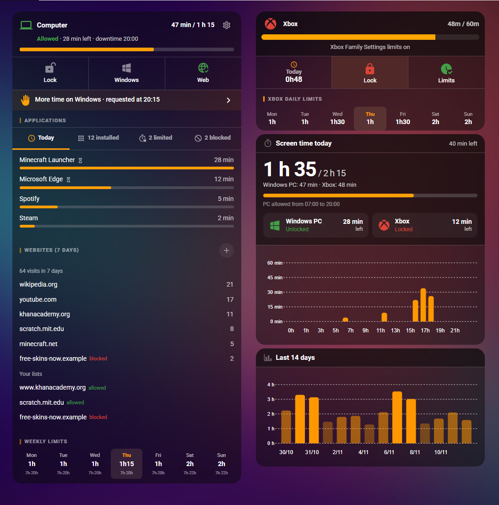

#  Microsoft Family Safety for Home Assistant

[![GitHub Release][releases-shield]][releases]
[![Marketplace][marketplace-shield]][marketplace]
[![License][license-shield]][license]
[](https://buymeacoffee.com/noiwid)

A full-featured Home Assistant custom integration for **Microsoft Family Safety**. Monitor screen time, manage app restrictions, lock accounts, control web filtering, and adjust daily limits — all from your Home Assistant dashboard.

Authentication is **native**: you sign in to Microsoft from Home Assistant itself. The Playwright auth add-on is no longer required and is kept only as a [legacy fallback](#legacy-add-on-mode).

**Supported platforms:** Windows, Xbox, Mobile

> **Domain:** `microsoft_family_safety` | **IoT Class:** Cloud Polling | **Languages:** English, French, German



⭐ **Enjoying this integration?** [Star it on GitHub](https://github.com/noiwid/HAFamilySafety): it gives the project visibility and helps other parents discover it.

## Also supervising Android devices?

[Google Family Link for Home Assistant](https://github.com/noiwid/HAFamilyLink) is the companion integration for Android phones and tablets. With both installed, all of your child's screen time can be followed in one place, in Home Assistant. This also makes a time budget shared across devices possible, something Google and Microsoft cannot do across each other's devices. It is not built in: an automation adds up `sensor.{prefix}_screen_time` and `sensor.<child>_daily_screen_time`, then locks the devices once the budget is spent.

---

## Disclaimer

This integration uses **unofficial, undocumented APIs** for Microsoft Family Safety. It is not approved, endorsed, or supported by Microsoft. Microsoft may modify or disable the underlying APIs at any time. Use at your own risk and in compliance with Microsoft's terms of service.

---

## Breaking changes

> **If you are upgrading from a version that used the Playwright auth add-on, read this before you upgrade.**

### Entity IDs change when you re-add the integration

Native authentication requires a **new config entry**. When you remove the old integration entry and add it again, Home Assistant generates fresh entity IDs, and the new ones include the device name as a prefix:

| Before | After |
|--------|-------|
| `number.firstname_sunday_limit` | `number.firstname_lastname_family_safety_firstname_sunday_limit` |
| `switch.firstname_lock` | `switch.firstname_family_safety_firstname_lock` |
| `button.firstname_approve_request` | `button.firstname_family_safety_firstname_approve_request` |

This **breaks dashboards, automations, scripts and templates** that reference the old IDs. After migrating:

1. Go to **Settings > Devices & Services > Entities** and check for entities marked *restored / unavailable* — those are the old IDs.
2. Either rename the new entities back to the old IDs (**Entities > entity > Settings > Entity ID**), which is the fastest way to keep existing YAML working, or update every reference.
3. Search your config for the old IDs:
   ```bash
   grep -rn "switch\.<name>_lock\|number\.<name>_.*_limit\|time\.<name>_" config/
   ```
   Don't forget **dashboard YAML**, **automations**, **scripts**, **scenes** and **template sensors**. The example dashboard in [`examples/dashboard.yaml`](examples/dashboard.yaml) already uses the prefixed IDs.

> Note the device-name prefix is not identical across platforms: sensors, numbers and time entities are prefixed with *first name + surname*, while switches and buttons are prefixed with the *first name only*.

### The add-on is no longer required

The Playwright auth add-on is now a **legacy fallback**. New installations should not install it. Existing installations keep working unchanged — see [Legacy add-on mode](#legacy-add-on-mode).

---

## Architecture

The integration authenticates natively inside Home Assistant and talks to both Microsoft backends itself. **No add-on, no browser automation, and no separate container are needed in the normal case.**

### The two Microsoft APIs

Microsoft Family Safety has **two distinct APIs**, each with its own authentication. The integration uses both:

| API | Base URL | Auth Method | Capabilities |
|-----|----------|-------------|-------------|
| **Mobile API** | `mobileaggregator.family.microsoft.com` | OAuth Bearer token (from a long-lived refresh token) | Almost everything: family roster, devices, usage, screen time schedules (Windows and Xbox), account lock, app blocking and app time limits, websites, age rating, ask-to-buy, requests. |
| **Web API** (private) | `account.microsoft.com/family/api/` | Microsoft session cookies + a `__RequestVerificationToken` antiforgery token | Xbox play time and the Xbox lock. Also a fallback for the schedules. |

Since 2.0.17-2.0.21 everything except those two Xbox features runs on the mobile API, the same way the Family Safety app works. That matters because Microsoft makes some accounts renew the web session with an interactive sign-in every 24 hours ([#52](https://github.com/noiwid/HAFamilySafety/issues/52)), while the mobile refresh token lasts. If your children have no Xbox, leave **Xbox** unticked among the monitored platforms and the integration does not use the web session at all (see [Xbox and the web session](#xbox-and-the-web-session)).

### How native authentication works

You sign in **once**, in your normal browser, through a short-lived reverse proxy that Home Assistant mounts inside its own HTTP server.

**Without Xbox among the monitored platforms**, that sign-in is the one the Family Safety app uses: Microsoft's mobile OAuth page, which hands back the refresh token for the mobile API, and that is all. No web session is created or stored.

**With Xbox ticked**, two things happen behind that single sign-in:

**Step 1 — Family web session.** The proxy serves the regular `account.microsoft.com` sign-in. Answer **Yes** to "Stay signed in?": that answer is what makes Microsoft issue persistent session cookies (valid for about a year), so the Family session no longer has to be renewed every few hours. (Before 2.0.4 the flow signed in through the mobile app's OAuth page instead, which never asks the question, and sessions expired after about 7 hours.) Once you are signed in, the same tab is redirected a few times so the Family dashboard can be loaded and its `__RequestVerificationToken` read. This part may take up to about 60 seconds; Home Assistant shows a waiting screen.

**Step 2 — mobile refresh token.** With the cookies from step 1, Home Assistant completes the mobile OAuth authorization **server-side**: Microsoft answers with a single redirect carrying the authorization code, with no second sign-in page. That code becomes the refresh token used for the mobile API. Should Microsoft ever require an interactive step here, the flow falls back to finishing it in your browser.

The browser part of step 1 is required and cannot be removed: a cold-start, purely server-side bootstrap is impossible because Microsoft gates the Family dashboard behind an interactive `prompt=none` OAuth hop.

### After sign-in: no browser at all

After the sign-in, Home Assistant talks to both APIs **directly over HTTPS** from the integration. The schedules go through the mobile API (`/v4/devicelimits/schedules`, the endpoint the Family Safety app uses), with the web API's `/family/api/st` as a fallback when a web session exists.

### Data flow

```
Poll loop (default every 5 min)
  ├─ Mobile API   → roster, devices, apps, usage, schedules (Windows + Xbox),
  │                 websites, content restrictions, app limits switch
  └─ Web API      → Xbox play time report, Xbox lock state (Xbox ticked only)

Service call / entity write
  ├─ Mobile API   → schedules, account lock, app blocking and app limits,
  │                 websites, age rating, ask-to-buy, requests, Xbox limits
  └─ Web API      → Xbox lock (Xbox ticked only)
```

### Legacy add-on mode

The `familysafety-playwright/` add-on is being phased out. Since 2.0.22 a new install can no longer choose it (the add-on URL and key fields are gone from the setup and options forms). Existing add-on entries keep working as before, and reauthenticating one (from the notification, Repairs or **Reconfigure**) moves it to the native sign-in for good: its add-on URL and key are cleared and the add-on can then be uninstalled.

The cases the add-on used to cover are handled natively now: an HTTP-only instance can sign in through the manual redirect step as long as **Xbox** is not ticked (the mobile token is all it needs), and the schedules no longer depend on a browser session at all.

Legacy and native mode are mutually exclusive per config entry; there is no automatic downgrade from native to add-on at runtime.

---

## Features

| Category | What you can do |
|----------|----------------|
| **Native authentication** | Sign in to Microsoft directly from Home Assistant — no add-on, no container, no copy-pasted redirect URL |
| **Account Lock** | Lock/unlock a child's entire account with a single switch |
| **Screen time monitoring** | Track daily usage per child and per device |
| **Allowed now / time left** | See per child and platform (Windows, Xbox) whether it may be used right now, the minutes left today, and when downtime starts and ends |
| **Screen time policies** | Adjust daily allowances and allowed time intervals per day — directly from the UI |
| **App management** | Block/unblock apps, set per-app time limits and windows, pause apps and resume them with their limits intact |
| **Web filtering** | Block/unblock domains (one or several per call), read the blocked and allowed lists, toggle content filtering (action or switch), set PEGI age ratings |
| **Purchase controls** | Enable/disable ask-to-buy via service call |
| **Request handling** | Approve or deny pending screen time requests from HA |
| **Connection diagnostics** | A dedicated sensor reports whether the mobile API and the web session are healthy |
| **Optimistic updates** | UI values update instantly when changing limits or intervals (reverts on failure) |

---

## Installation

### Prerequisites

- **Home Assistant** 2024.1.0 or newer, running on any installation type (OS, Supervised, Container, Core)
- A Home Assistant URL reachable from your browser over **HTTPS**. If your instance is HTTP-only on the local network, see [`allow_insecure_http_auth`](#insecure-local-http-authentication)
- A **Microsoft parent account** with at least one child in the Family Safety group

> No add-on and no Docker container are required.

### Step 1 — Install the Integration

#### Via the Marketplace (Recommended)

1. Go to **Settings > Marketplace > Browse**
2. Search for **Microsoft Family Safety** and install it
3. Restart Home Assistant

#### Manual Installation

1. Download the latest release from [GitHub Releases](https://github.com/noiwid/HAFamilySafety/releases)
2. Copy the `custom_components/microsoft_family_safety` folder into your `config/custom_components/` directory
3. Restart Home Assistant

### Step 2 — Configure the Integration

1. Go to **Settings > Devices & Services > Add Integration**
2. Search for **Microsoft Family Safety**
3. Set the **update interval** and the **monitored platforms** (Windows, Xbox, Mobile). Tick **Xbox** only if your children use one: without it the sign-in is shorter and Home Assistant never needs the Microsoft web session. Click **Submit**
4. Home Assistant shows an **Open website** button. Click it: a browser window opens on the Microsoft sign-in page, served through Home Assistant's temporary authentication proxy
5. Sign in with your **Microsoft parent account** (the family organizer, not a child account) and complete MFA if prompted. With Xbox ticked, answer **Yes** when Microsoft asks **"Stay signed in?"**: this is what keeps the web session valid for longer than a few hours
6. **Keep the window open and be patient.** With Xbox ticked, Home Assistant completes the Family session in the background after the visible sign-in and fetches the mobile token from the same sign-in. The waiting screen can sit for **up to about a minute** without visibly updating, and the tab may briefly redirect again — this is normal. Do not click *Open website* again and do not close the dialog; wait for it to switch to the completion screen on its own. Without Xbox, the window finishes as soon as Microsoft hands back the token
7. When both steps complete, the window closes itself and Home Assistant shows **Microsoft Family Safety sign-in completed**. Click **Continue**
8. The integration discovers all child accounts and devices automatically. Screen-time entities can read `unknown` for up to one update interval (5 minutes by default) while the first data pull completes; that is expected

> The old flow — copy an auth URL, sign in, paste the redirect URL back — is gone in the normal case. It survives as a fallback on HTTP-only instances, for legacy add-on users and for entries without Xbox (which only need the mobile token).

### Integration Options

**Settings > Devices & Services > Microsoft Family Safety > Configure**:

| Option | Range / Format | Default | Notes |
|--------|----------------|---------|-------|
| Update interval (seconds) | 30 – 3600 | 300 (5 min) | |
| Monitored platforms | Windows / Xbox / Mobile | Windows | One lock switch per platform. Xbox also decides whether the web session is used, see [below](#xbox-and-the-web-session) |
| Users allowed to control Microsoft Family Safety | list of Home Assistant users | *(empty: everybody)* | See [Who can control the integration](#who-can-control-the-integration) |
| Allow insecure local HTTP authentication (testing only) | on / off | off | See below |
| Link the Xbox Family Settings sign-in | on / off | off | Only with Xbox ticked; for when the Connection sensor shows `xbox_family: not_linked`. Opens a Microsoft sign-in through the same temporary proxy as the setup, which picks up the result itself: sign in, close the window, done. A passkey does not work through the proxy (it is tied to Microsoft's address), here or in the main sign-in: choose *Sign in another way*. Without an HTTPS URL (or the local HTTP option below), or if the sign-in does not finish within 10 minutes, you paste the address of the blank page Microsoft ends on instead |

#### Who can control the integration

Home Assistant lets every user press any button, flip any switch or change any number, unless an entity permission policy says otherwise, and Home Assistant has no screen to write such policies. If your child has a Home Assistant account, they could otherwise lift their own limits from the integration's entities.

The option **Users allowed to control Microsoft Family Safety** closes that gap:

- **Empty** (default): nothing changes, every user can use the buttons and settings.
- **Some users ticked**: only they and the administrators can. Any other account is refused, with a warning in the log, on every button, switch, daily limit and time window of the integration, and on every `microsoft_family_safety.*` action.
- Automations and scripts started by Home Assistant itself are never affected. A script started by a person from the dashboard runs with that person's rights.

Give the child a **non-administrator** account and tick the parents: an administrator can change this option, so a child with an administrator account bypasses it. The child still sees the entities (Home Assistant cannot hide them per user) but can no longer use them. Changing the option takes effect immediately, without reloading the integration.

#### Xbox and the web session

Xbox play time and the Xbox lock are the only features that still need the Microsoft **web session**, which some accounts must renew with an interactive sign-in every 24 hours ([#52](https://github.com/noiwid/HAFamilySafety/issues/52)). Everything else, Xbox daily limits included, runs on the mobile token.

- **Xbox ticked** among the monitored platforms: the sign-in captures both the web session and the mobile token, and the Xbox entities are created. Installs made before 2.0.22 keep this behaviour (the options show Xbox ticked) until you untick it.
- **Xbox unticked** (the default for new installs): the integration runs on the mobile token only. The sign-in is the short one of the Family Safety app, no browser cookies are stored, the connection sensor no longer reports `degraded` for a missing web session, and no Xbox entities are created (Xbox lock, Xbox schedule switch, Xbox daily limits).

Unticking Xbox later takes effect at once; the web credentials already stored stay unused and are removed at the next reauthentication. Ticking it again starts a reauthentication so the web session can be captured. Xbox entities created earlier stay in the entity list as unavailable; remove them there if you like.

#### Insecure local HTTP authentication

Native authentication proxies your Microsoft credentials through Home Assistant, so it **requires an HTTPS Home Assistant URL** by default. If your instance is only reachable over plain HTTP on your LAN, you can tick **Allow insecure local HTTP authentication (testing only)**.

This option is deliberately narrow:

- it is accepted **only** for `localhost`, `homeassistant`, `*.local`, or a private / loopback / link-local IP address — a public HTTP URL is rejected with *"Insecure HTTP authentication is allowed only through localhost, .local, or a private/local IP address"*;
- while it is active, your Microsoft password and session data travel **unencrypted across your local network**, and a WARNING is written to the Home Assistant log for every sign-in.

Use it for testing, or on a network you fully trust. Setting up HTTPS is the better answer.

### Re-authenticating

Microsoft sessions expire. The account page session lapses about once a day; since 2.0.6 the integration completes Microsoft's silent sign-in on its own (the same "Continue" step a browser performs), so you should not be asked to sign in again as long as the "Stay signed in?" cookies are valid. When the login itself is gone, Home Assistant raises a **repair / reauthentication** prompt and a persistent notification. That also covers the case where Microsoft has dropped the Family session while the account page still answers: after two consecutive updates in that state the connection sensor reports `degraded` with `reauth_recommended: true` and the reauthentication flow is started for you. You can also start it yourself at any time with the `microsoft_family_safety.request_reauth` service (handy from a dashboard button). Re-authenticating runs the same sign-in and renews **both** the Family web session and the mobile refresh token (only the token without Xbox).

Since 2.0.20 a dead web session no longer triggers a reauthentication on its own as long as the schedules answer through the mobile API: only the Xbox features stop working. Without Xbox, the web session is not used at all and only an expired mobile token can ask you to sign in again.

Reauthentication must use the **same Microsoft account** — signing in with a different one aborts with *"A different Microsoft account was used"*.

#### Daily sign-in on some accounts, and a community workaround

Since early October 2026, Microsoft asks some accounts for an interactive Family sign-in every 24 hours, whatever the cookies say (see [#52](https://github.com/noiwid/HAFamilySafety/issues/52)). The connection sensor then reports `signin_required`, and nothing server-side can avoid the sign-in itself.

Since 2.0.20 this only affects the Xbox play time and the Xbox lock: everything else keeps working on the mobile token and the integration no longer asks you to sign in for it. If your children have no Xbox, untick **Xbox** among the monitored platforms and the question goes away entirely.

If you rely on the Xbox play time or the Xbox lock and want the daily sign-in unattended, [BartVPL/HAFamilySafety-Auto-Reauth](https://github.com/BartVPL/HAFamilySafety-Auto-Reauth) is a community project that watches the connection sensor, drives the sign-in through Playwright on a separate Linux host, reads the one-time code Microsoft emails through the Gmail API, and completes the flow. It only uses what the integration already exposes (the connection sensor, the `request_reauth` service and the reauth flow). Read its README before installing: it is **not part of this integration, not reviewed here and experimental**. It needs a long-lived Home Assistant token, read-only OAuth access to the mailbox that receives the Microsoft codes, and runs a browser on a machine you must keep secure. Weigh that against signing in by hand once a day.

### Legacy add-on installation

New installs no longer use the add-on (see [Legacy add-on mode](#legacy-add-on-mode)). This section remains for entries that still run on it. Reauthenticating such an entry moves it to the native sign-in, after which the add-on and its standalone container (see [`familysafety-playwright/README.standalone.md`](familysafety-playwright/README.standalone.md)) can be removed.

#### Add-on Configuration

| Option | Default | Description |
|--------|---------|-------------|
| `log_level` | `info` | Logging verbosity (`trace`, `debug`, `info`, `warning`, `error`) |
| `auth_timeout` | `300` | Seconds to wait for user to complete authentication (60-600) |
| `session_duration` | `86400` | Session validity in seconds (1h-7d) |
| `language` | *(auto)* | Browser locale (e.g., `fr-FR`, `en-US`) |
| `timezone` | *(auto)* | Browser timezone (e.g., `Europe/Paris`) |
| `vnc_password` | `familysafety` | Password for the noVNC interface |
| `api_key` | *(auto)* | Only needed when Home Assistant runs on another host |

---

## Devices & Entities

The integration creates two types of HA devices, plus one integration-level diagnostic entity:

| Device Type | Name Example | Manufacturer | Model |
|-------------|-------------|--------------|-------|
| Child account | Firstname Lastname (Family Safety) | Microsoft | Family Safety Account |
| Physical device | DESKTOP-EXAMPLE | From API | From API |

Physical devices are linked to their parent child account via `via_device`.

> **Entity IDs are prefixed with the device name.** A "Sunday Limit" number on the device *Firstname Lastname (Family Safety)* becomes `number.firstname_lastname_family_safety_firstname_sunday_limit`. Switch and button entities use a device named with the first name only, so they are prefixed differently. See [Breaking changes](#breaking-changes). The tables below use `{prefix}` for that device-name prefix.

### Entity count per child

For one child with no per-app switches, an account with Windows monitoring enabled produces roughly:

| Platform | Count | What |
|----------|-------|------|
| `sensor` | 8 – 11 | Screen Time, Account Info, Applications, Pending Requests, Web Filter, Websites Visited, Screen Time Policy, Windows Time Remaining (+ Balance when the account exposes one, + Xbox Screen Time and Xbox Time Remaining with Xbox data) |
| `binary_sensor` | 2 (+2 Xbox) | Windows Allowed Now, Windows Downtime Active, plus the same two for the Xbox once its schedule is read |
| `switch` | 5 + platforms + apps | Account Lock, Screen Time Limits, Xbox Screen Time Limits, App Limits, Web Filtering, one Platform Lock per monitored platform, one per application |
| `button` | 2 | Approve Request, Deny Request |
| `number` | 7 (+7 Xbox) | one daily limit per day, plus one Xbox daily limit per day once the Xbox schedule is on |
| `time` | 14 | 7 start + 7 end |

Plus **2 sensors per physical device** (screen time, info) and **1 connection sensor per config entry**.

A typical single-child setup with a full app list lands around 85-90 entities.

### Sensors — Per Child Account

| Entity | Entity ID | State | Key Attributes |
|--------|-----------|-------|----------------|
| Screen Time | `sensor.{prefix}_screen_time` | Minutes used today | `formatted_time`, `hours`, `minutes`, `average_screentime`, `date`, `raw_microsoft_minutes`, `last_api_poll`, `update_interval_seconds` |
| Account Info | `sensor.{prefix}_account_info` | Full name | `user_id`, `first_name`, `surname`, `profile_picture`, `device_count` |
| Applications | `sensor.{prefix}_applications` | App count | `blocked_count`, `applications`, `paused_apps` (apps paused by `pause_app`: `app_id`, `app_name`, `paused`: `ours` while still blocked, `parent` once someone unblocked them) |
| Balance | `sensor.{prefix}_balance` | Account balance | *(monetary sensor, only if available)* |
| Pending Requests | `sensor.{prefix}_pending_requests` | Request count | `requests` |
| Web Filter | `sensor.{prefix}_web_filter` | enabled / disabled / unknown | `blockedSites`, `allowedSites`, `contentRatingAge`, `content_settings`, `max_age_rating`, `acquisition_policy` |
| Websites Visited | `sensor.{prefix}_websites_visited` | Visits in Edge over the last 7 days | `report_available`, `site_count`, `blocked_count`, `sites` (50 most visited: `domain`, `visits`, `last_visit`, `blocked`), `searches` (50 latest search terms, one row per term: `search`, `visits`, `date`, `site`; times in UTC with an offset). Read every 30 min; `report_available: false` when Microsoft has no Edge data for the child. `sites` and `searches` are not stored in the history database |
| Screen Time Policy | `sensor.{prefix}_screen_time_policy` | enabled / disabled / unknown | `monday_allowance` … `sunday_allowance`, `*_allowed_intervals`, `daily_restrictions`; with the Xbox Family Settings sign-in linked, also `xbox_monday_allowed_intervals` … `xbox_sunday_allowed_intervals` (the Xbox allowed hours, e.g. `[{begin: "07:00", end: "22:00"}]`) |
| Windows Time Remaining | `sensor.{prefix}_windows_time_remaining` | Minutes the child may still use Windows today | `allowed_now`, `reason`, `allowance_minutes`, `used_minutes`, `limits_enabled`, `allowed_ranges`. Same rules as Allowed Now below |
| Xbox Screen Time | `sensor.{prefix}_xbox_screen_time` | Minutes of Xbox play today | Created with the Xbox features on, once Xbox data was read |
| Xbox Time Remaining | `sensor.{prefix}_xbox_time_remaining` | Minutes the child may still play on the Xbox today | As Windows Time Remaining, on the Xbox schedule, Xbox play time and Xbox lock or extra time |

### Binary Sensors — Per Child Account and Platform

One of each for Windows, and for the Xbox once its schedule has been read. They only use what the integration already polls (schedule, today's usage, locks and extra time) and are re-evaluated every minute, since allowed hours move with the clock between updates.

| Entity | Entity ID | State | Key Attributes |
|--------|-----------|-------|----------------|
| Allowed Now | `binary_sensor.{prefix}_{platform}_allowed_now` | ON while the platform may be used now | `reason`, `allowance_minutes`, `used_minutes`, `in_allowed_hours`, `override`, `override_until`. The minutes left are on Time Remaining only, so this entity writes a state when something other than the clock changes |
| Downtime Active | `binary_sensor.{prefix}_{platform}_downtime_active` | ON outside today's allowed hours | `downtime_start`, `downtime_end` (the current downtime, or the next one, local ISO times) |

**How Allowed Now and Time Remaining decide**, in this order:

1. A lock in force (`reason: locked`) → off, 0 minutes left. Extra time granted (`extra_time`) → on until it ends.
2. Limits turned off for the platform (`no_limits`) → on, counting down to midnight.
3. Outside today's allowed hours (`outside_allowed_hours`) → off, 0 minutes.
4. Today's allowance used up (`allowance_used`) → off, 0 minutes. Otherwise on (`within_limits`), with the smaller of the allowance left and the time to the end of the current allowed window.

Windows uses the Windows schedule and the minutes of the child's Windows devices; the Xbox uses the Xbox schedule, Xbox play time and the lock or extra time in the Xbox policy. The state is `unknown` (`reason: unknown`) while the schedule or today's usage has not been read, for example for a child without a Windows device. `used_minutes` (and `allowed_ranges` on Time Remaining) are not stored in the history database.

- All the time logic (allowed hours, today's allowance, midnight) uses Home Assistant's time zone, not the child's device's.
- Windows extra time is not taken into account: Microsoft gives no Windows "allowed until" time. After an approved request for more time, Windows Allowed Now can stay off with `reason: allowance_used` (and Time Remaining at 0) while the child is in fact allowed. Xbox extra time is read from the Xbox policy and counts.

### Sensors — Per Physical Device

| Entity | Entity ID | State | Key Attributes |
|--------|-----------|-------|----------------|
| Device Screen Time | `sensor.{device}_screen_time` | Minutes used today | — |
| Device Info | `sensor.{device}_info` | Device name | `model`, `OS`, `last_seen` |

### Sensor — Per Integration

| Entity | Entity ID | State | Key Attributes |
|--------|-----------|-------|----------------|
| Connection | `sensor.microsoft_family_safety_connection` | connected / degraded / disconnected | `mobile_api`, `web_session`, `web_api`, `family_context`, `screentime_policy_source`, `native_web_auth`, `reauth_required`, `reauth_recommended`, `last_update_success` |

`degraded` means the mobile API works but the Family web session does not. Since 2.0.20 that only affects the Xbox play time and the Xbox lock; the schedules keep working on the mobile API. Without Xbox the web session is not used and the state is `connected` whenever the mobile API answers (attribute `xbox_features: false`). When that state persists for two consecutive updates, `reauth_recommended` turns `true`, a notification is raised and the reauthentication flow is started automatically. Only a real login redirect, an expired account session or that two-update condition triggers reauthentication; a single rejected request does not, to avoid loops on a merely stale token. This is a **diagnostic** entity; enable it in the entity list if it is hidden.

### Switches — Per Child Account

| Entity | Entity ID | Behavior |
|--------|-----------|----------|
| **Account Lock** | `switch.{prefix}_lock` | **ON = account locked** (all screen time set to 0). Saves quotas before locking, restores on unlock. Persists across restarts. Attribute `has_saved_policy` shows whether a restore point exists. |
| **Screen Time Limits** | `switch.{prefix}_screen_time_limits` | OFF = the Windows schedule is turned off, every day kept as it is. ON = turned back on. Same switch as in the Family Safety app (before 2.0.20 it rewrote every day to 24 h). |
| Xbox Screen Time Limits | `switch.{prefix}_xbox_screen_time_limits` | Turns the child's separate Xbox schedule on or off (the days are kept). Once it is on, seven `number.{prefix}_xbox_{day}_limit` entities set the daily Xbox allowance the console enforces; with the Xbox Family Settings sign-in linked, each also shows that day's Xbox allowed hours in its `allowed_intervals` attribute. Not created without Xbox among the monitored platforms. |
| App Limits | `switch.{prefix}_app_limits` | The "App, feature, and game limits" toggle above the app list. While it is OFF, the per-app time limits are kept but not enforced. |
| Web Filtering | `switch.{prefix}_web_filtering` | ON = Microsoft filters inappropriate websites and searches in Microsoft Edge, and the blocked and allowed lists apply. Same write as the `toggle_web_filter` action. |
| App Block | `switch.{prefix}_app_{appname}` | ON = app blocked. One switch per application. |
| Platform Lock | `switch.{prefix}_{platform}_lock` | ON = platform locked. Locks one platform (e.g. Windows) through a Microsoft device override. For Windows the integration tries a web-API time override first, then falls back to the mobile API. Use **Account Lock** to lock every platform at once. |

### Buttons — Per Child Account

| Entity | Entity ID | Action |
|--------|-----------|--------|
| Approve Request | `button.{prefix}_approve_request` | Approves the oldest pending screen time request (+1 hour) |
| Deny Request | `button.{prefix}_deny_request` | Denies the oldest pending request |

### Number Entities — Per Child Account (7 per child)

| Entity | Entity ID | Range | Step |
|--------|-----------|-------|------|
| Daily Limit | `number.{prefix}_{day}_limit` | 0 – 1440 minutes | 15 min |

One entity per day of the week (Sunday through Saturday). Adjustable directly from the UI with **optimistic updates** — values reflect immediately. A whole-day allowance, which Microsoft sends as `1.00:00:00`, reads as 1440 (earlier versions read it as 0).

### Time Entities — Per Child Account (14 per child)

| Entity | Entity ID | Description |
|--------|-----------|-------------|
| Interval Start | `time.{prefix}_{day}_start` | Start of the allowed screen time window |
| Interval End | `time.{prefix}_{day}_end` | End of the allowed screen time window |

One start/end pair per day of the week, editable from the UI with optimistic updates.

> **The `time.*_end` entities are now populated.** They existed before but stayed `unknown` on many accounts because the end of the allowed window was not parsed from Microsoft's response. Interval parsing now reads the `timeline` array and the *last* allowed interval, so both ends of the window are correct. Microsoft's `24:00:00` end-of-day value is clamped to `23:59`.

---

## Services

The integration exposes **23 services**, split between the pyfamilysafety library, the web API and the Xbox Family Settings service, plus one to start the sign-in flow on demand.

Every service that acts on one child takes the child either as `account_id` (the Microsoft user ID, shown in the `user_id` attribute of the child's entities) or as `entity_id`: any Microsoft Family Safety entity of that child or of one of its devices. `device_id` works the same way: the child's Microsoft Family Safety device or one of its physical devices. The account is looked up from the entity or device, so automations need no hard-coded ID. Lists are accepted as long as everything in them belongs to the same child. When `account_id` is given, it wins.

These can go under `data:` or under `target:`. A `target:` may name entities and devices only: `area_id`, `floor_id` and `label_id` are refused, since an area can hold several children's devices.

```yaml
# Same as account_id: "1234567890123456", read from the child's lock switch
service: microsoft_family_safety.lock_account
target:
  entity_id: switch.firstname_lock
```

### Account Lock

```yaml
# Lock a child account (sets all screen time to 0, saves current policy)
service: microsoft_family_safety.lock_account
data:
  account_id: "1234567890123456"
```

```yaml
# Unlock a child account (restores saved policy)
service: microsoft_family_safety.unlock_account
data:
  account_id: "1234567890123456"
```

```yaml
# Lock a single platform (use lock_account to lock every platform at once)
service: microsoft_family_safety.lock_platform
data:
  account_id: "1234567890123456"
  platform: "Windows"
  duration_hours: 24
```

```yaml
# Unlock a single platform
service: microsoft_family_safety.unlock_platform
data:
  account_id: "1234567890123456"
  platform: "Windows"
```

#### Xbox extra time

`add_time_bonus` gives a child extra time on the Xbox, for some `minutes` (1 – 1440) or `until` a time (at most 24 hours ahead); `cancel_time_bonus` takes it back. Both go through the Xbox Family Settings service (the same "add time" as the Xbox Family Settings app), so they need **Xbox** among the monitored platforms and the Xbox Family Settings sign-in linked; otherwise they fail with an error saying so. They never use the web session.

- Microsoft keeps **one** Xbox override, so extra time replaces a lock. While the Xbox is locked (by `lock_platform` or by a parent in the app), `add_time_bonus` is refused unless you pass `replace_lock: true`.
- The extra time is believed only when Microsoft's answer lists it ending when asked; otherwise the action fails. If a lock is still listed afterwards, the action fails and the lock stays.
- While extra time runs, the Xbox lock switch reads off (Microsoft reports `allowUntil`).
- `cancel_time_bonus` only ever cancels extra time. While the Xbox is locked it fails without sending anything (the cancel would lift the lock too); with no extra time in force it does nothing.
- A lock that extra time replaced (`replace_lock: true`) does not come back: after `cancel_time_bonus`, or when the extra time ends, the Xbox follows its schedule again. Lock it again with `lock_platform` if needed.
- Both can answer with what they did (`response_variable`): `add_time_bonus` with `{added, until, replaced_lock}`, `cancel_time_bonus` with `{cancelled: true, lock_in_force}` or `{cancelled: false, reason: "no_extra_time"}`.
- Windows has no confirmed request for extra time yet, so only `platform: "Xbox"` (the default) is accepted.

```yaml
# 30 minutes of extra time on the Xbox
service: microsoft_family_safety.add_time_bonus
data:
  account_id: "1234567890123456"
  minutes: 30
```

```yaml
# One more hour even though the Xbox is locked: the lock is replaced
service: microsoft_family_safety.add_time_bonus
data:
  account_id: "1234567890123456"
  minutes: 60
  replace_lock: true
response_variable: extra_time
```

```yaml
# End the Xbox extra time early (the child as one of its entities)
service: microsoft_family_safety.cancel_time_bonus
data:
  entity_id: switch.firstname_xbox_lock
```

### App Management

```yaml
# Block an application
service: microsoft_family_safety.block_app
data:
  account_id: "1234567890123456"
  app_id: "app-uuid"
```

```yaml
# Unblock an application
service: microsoft_family_safety.unblock_app
data:
  account_id: "1234567890123456"
  app_id: "app-uuid"
```

```yaml
# Set a per-app daily time limit with allowed window
service: microsoft_family_safety.set_app_time_limit
data:
  account_id: "1234567890123456"
  app_id: "app-uuid"
  app_name: "Minecraft"
  platform: "windows"
  hours: 1
  minutes: 30
  start_time: "08:00:00"
  end_time: "20:00:00"
```

```yaml
# Remove a per-app time limit
service: microsoft_family_safety.remove_app_time_limit
data:
  account_id: "1234567890123456"
  app_id: "app-uuid"
  app_name: "Minecraft"
  platform: "windows"
```

```yaml
# Pause Windows or Xbox apps for now (blocks them, keeping their time limit)
service: microsoft_family_safety.pause_app
data:
  account_id: "1234567890123456"
  apps:
    - "x:app-id"
    - "appx:app-id"
```

```yaml
# Resume paused apps: puts back the time limit (or none) each had before.
# Leave out apps to resume every paused app of the child.
service: microsoft_family_safety.resume_app
data:
  account_id: "1234567890123456"
  apps:
    - "x:app-id"
```

`pause_app` first reads each app's policy (from Microsoft's app activity report) and saves it in Home Assistant's storage, so it survives a restart. An app with a time limit is blocked with its limit kept stored (a plain `block_app` would wipe the limit); an app without one is blocked like `block_app` does. A second pause of the same app keeps what the first one saved. Apps that are already blocked are skipped and never touched, and an app whose policy cannot be read is not paused, since there would be nothing safe to put back. `resume_app` reads the policy again and writes the saved one back unblocked. An app that someone unblocked in the meantime is reported as `released`, and one whose limit or block a parent changed as `changed_by_parent`; both are left as the parent set them. The app's block switch and `unblock_app` resume a paused app the same way (its limit comes back), and `block_app` on a paused app keeps it paused with its limit stored. An unblock never wipes a Windows or Xbox app's limit either: an app that is already unblocked is left as it is, and a blocked app with a limit is unblocked with its limit kept; an app that cannot be read is not unblocked. Saved states stay until resumed or until the integration entry is removed. Both services answer with what they did, per app, when called with `response_variable`, and fail when every app failed:

```yaml
# pause_app
{"account_id": "1234567890123456", "paused": ["x:app-id"], "changed_by_parent": [], "skipped": {"appx:other": "already blocked"}, "failed": {}}
# resume_app
{"account_id": "1234567890123456", "resumed": ["x:app-id"], "released": [], "changed_by_parent": [], "skipped": {}, "failed": {}}
```

### Screen Time

```yaml
# Set daily screen time allowance
service: microsoft_family_safety.set_screentime_limit
data:
  account_id: "1234567890123456"
  day_of_week: 1  # 0=Sunday, 6=Saturday
  hours: 2
  minutes: 0
```

```yaml
# Set allowed time window (30-min precision)
service: microsoft_family_safety.set_screentime_intervals
data:
  account_id: "1234567890123456"
  day_of_week: 1
  start_hour: 8
  start_minute: 0
  end_hour: 20
  end_minute: 30
```

#### Xbox daily limit and allowed hours

Both services take an optional `platform`: `Windows` (the default, unchanged behaviour) or `Xbox`. With `Xbox` they write the child's Xbox schedule through the Xbox Family Settings service, the one the console enforces:

- `set_screentime_limit` sets the day's Xbox limit and keeps its allowed hours;
- `set_screentime_intervals` sets the day's Xbox **allowed hours** (the time window the child may play in, like a bedtime) and keeps its limit. The window lies within one day, on the hour or half hour; `end_hour: 24` means midnight.

Xbox must be among the monitored platforms, the Xbox Family Settings sign-in must be linked and the child must match one child of the Xbox family by first and last name. Otherwise the action fails with a message saying which of these is missing, and nothing is written: the Xbox schedule of the Family Safety mobile API is not used as a fallback, because the console no longer enforces it ([#70](https://github.com/noiwid/HAFamilySafety/issues/70)). The allowed hours only apply while the child's Xbox schedule is on (**Xbox Screen Time Limits** switch).

```yaml
# Xbox allowed hours on Fridays: 16:00 to 21:30
action: microsoft_family_safety.set_screentime_intervals
data:
  account_id: "1234567890123456"
  platform: Xbox
  day_of_week: 5
  start_hour: 16
  end_hour: 21
  end_minute: 30
```

```yaml
# Xbox limit on Saturdays: 3 hours
action: microsoft_family_safety.set_screentime_limit
data:
  account_id: "1234567890123456"
  platform: Xbox
  day_of_week: 6
  hours: 3
```

### Request Handling

```yaml
# Approve a pending screen time request (+N minutes)
service: microsoft_family_safety.approve_request
data:
  request_id: "request-uuid"
  extension_minutes: 60
```

```yaml
# Deny a pending request
service: microsoft_family_safety.deny_request
data:
  request_id: "request-uuid"
```

### Web Filtering

```yaml
# Block a website
service: microsoft_family_safety.block_website
data:
  account_id: "1234567890123456"
  website: "example.com"
```

```yaml
# Allow a website (always-allowed list)
service: microsoft_family_safety.allow_website
data:
  account_id: "1234567890123456"
  website: "example.com"
```

```yaml
# Remove a website from the blocked or allowed list
service: microsoft_family_safety.remove_website
data:
  account_id: "1234567890123456"
  website: "example.com"
```

```yaml
# Block several websites in one call (also works for allow_website and remove_website)
service: microsoft_family_safety.block_website
data:
  account_id: "1234567890123456"
  website:
    - "example.com"
    - "example.net"
response_variable: result
```

Each site is its own request to Microsoft. The same site given twice (`example.com`, `https://example.com`, `EXAMPLE.com`) is sent once, and a list with no site left after blanks are dropped is refused. Every site in the list is tried, also after one fails; if any fails, the call fails with a message naming the sites that were done and the sites that failed (with Microsoft's error), so an automation can retry just those. The response is optional; asked for, a successful call answers the sites done:

```yaml
{"done": ["example.com", "example.net"], "failed": []}
```

```yaml
# Toggle web content filtering
service: microsoft_family_safety.toggle_web_filter
data:
  account_id: "1234567890123456"
  enabled: true
```

```yaml
# Read the blocked and allowed websites
service: microsoft_family_safety.get_sites
data:
  account_id: "1234567890123456"
response_variable: sites
```

`get_sites` answers with `blocked` and `allowed` exactly as Microsoft stores them (absolute URLs, e.g. `https://example.com`), and `filter_enabled`:

```yaml
{"account_id": "1234567890123456", "blocked": ["https://example.com"], "allowed": ["https://example.org"], "filter_enabled": true}
```

### Content & Purchase Controls

```yaml
# Set age rating (PEGI 3-20, or 21 for unrestricted)
service: microsoft_family_safety.set_age_rating
data:
  account_id: "1234567890123456"
  age: 12
```

```yaml
# Enable or disable ask-to-buy
service: microsoft_family_safety.set_acquisition_policy
data:
  account_id: "1234567890123456"
  require_approval: true
```

### Reauthentication

Starts the Microsoft sign-in flow immediately, without waiting for the integration to detect an expired session. Useful behind a dashboard button (the example card's connection pill opens the integration page for the same purpose). No fields.

```yaml
service: microsoft_family_safety.request_reauth
```

---

## Automation Examples

> The examples below use short placeholder entity IDs (`switch.firstname_lock`). **Your actual IDs include the device-name prefix** — e.g. `switch.firstname_family_safety_firstname_lock`. Copy the real IDs from **Developer Tools > States**, or rename the entities to the short form. See [Breaking changes](#breaking-changes).

### Lock account on school nights

```yaml
automation:
  - alias: "Lock account at 21:00"
    trigger:
      - platform: time
        at: "21:00:00"
    condition:
      - condition: time
        weekday: [sun, mon, tue, wed, thu]
    action:
      - action: switch.turn_on
        target:
          entity_id: switch.firstname_lock

  - alias: "Unlock account at 07:00"
    trigger:
      - platform: time
        at: "07:00:00"
    action:
      - action: switch.turn_off
        target:
          entity_id: switch.firstname_lock
```

### Screen time alert

```yaml
automation:
  - alias: "Screen time limit alert"
    trigger:
      - platform: numeric_state
        entity_id: sensor.firstname_screen_time
        above: 120
    action:
      - action: notify.mobile_app_your_phone
        data:
          title: "Screen Time Alert"
          message: >
            {{ state_attr('sensor.firstname_screen_time', 'formatted_time') }}
            of screen time used today.
```

### Warn before time runs out

```yaml
automation:
  - alias: "Five minutes of Xbox left"
    trigger:
      - platform: numeric_state
        entity_id: sensor.firstname_xbox_time_remaining
        below: 6
    condition:
      - condition: state
        entity_id: binary_sensor.firstname_xbox_allowed_now
        state: "on"
    action:
      - action: notify.mobile_app_your_phone
        data:
          message: "Five minutes of Xbox left today."
```

### Set weekday limits automatically

```yaml
automation:
  - alias: "Set weekday screen time limits"
    trigger:
      - platform: time
        at: "00:05:00"
    condition:
      - condition: time
        weekday: [mon, tue, wed, thu, fri]
    action:
      - action: microsoft_family_safety.set_screentime_limit
        data:
          account_id: "1234567890123456"
          day_of_week: "{{ now().weekday() }}"
          hours: 1
          minutes: 30
```

### Watchdog — prevent manual unlock

```yaml
automation:
  - alias: "Anti-bypass watchdog"
    trigger:
      - trigger: state
        entity_id: switch.firstname_lock
        to: "off"
    condition:
      - condition: time
        after: "21:00:00"
        before: "07:00:00"
    action:
      - action: switch.turn_on
        target:
          entity_id: switch.firstname_lock
```

### Dashboard card

A clean per-child panel is available as a [decluttering-card](https://github.com/custom-cards/decluttering-card) template, so you drop one card per child and only change a few variables. It includes:

- A header with the day's progress bar and allowed window, plus a clickable connection-health pill (opens the integration to re-authenticate)
- Screen time used, blocked-app count, pending-request count
- When a request is pending: what is being asked (platform and time of the request, tooltip with Microsoft's message), with Approve (grants 1 hour) / Deny buttons
- Lock, Windows-lock and screen-time-limits switches
- Today's top apps, and the weekly limits grid (tap to edit the limit, hold to edit the window)

Two files:

- [`examples/family-safety-card.yaml`](examples/family-safety-card.yaml) — the `fs_child` template only.
- [`examples/dashboard.yaml`](examples/dashboard.yaml) — a full example view instantiating it with placeholder entities.

**Required Marketplace dashboard cards:** `decluttering-card`, `button-card`, `vertical-stack-in-card`, `card-mod`, `mushroom`

Paste the `decluttering_templates:` block into your dashboard (a dashboard has exactly one such key — merge, do not duplicate), then add one `custom:decluttering-card` per child, filling `child`, `lock` and `title`. Entity IDs carry the device-name prefix; look them up under **Settings → Devices & Services → Entities**. See the comments at the top of each file.

To add more children, add one `custom:decluttering-card` block per child in the same view; the shared template updates every card at once.

---

## Troubleshooting

### The sign-in window shows "400 Bad Request"

Home Assistant's built-in `security_filter` middleware rejects URLs whose query string looks like a file-injection attempt, using the pattern `[a-zA-Z0-9_]=/([a-z0-9_.]//?)+`. Some of Microsoft's silent-SSO redirects carry parameters such as `epctrc=/w/...`, which match that pattern, and the request is refused before the integration ever sees it.

The integration carries such a query in an encoded form on its way through Home Assistant and restores it before it reaches Microsoft. The filter itself is not changed.

If you still hit a 400 during authentication, retry the flow; check the Home Assistant log for `security_filter` entries, and open an issue with the (redacted) URL.

### Microsoft asks "Work or school account" or "Personal account"

This page appears when the same address exists as both kinds of Microsoft account, sometimes again after you have signed in. Pick **Personal account**: Family Safety only works with it. The setup then continues on its own.

### "Microsoft authentication host not allowed"

Microsoft's sign-in page links some of its own pages with an explicit port (`login.microsoftonline.com:443`), and versions before 2.0.4 rejected that host. Update to 2.0.4 or later; the port is ignored now. If you still see it, the host in the address bar after `__ms_host__/` is not one of the sign-in hosts (`account.microsoft.com`, `account.live.com`, `login.live.com`, `login.microsoft.com`, `login.microsoftonline.com`), which the proxy deliberately refuses. Please open an issue with that host name.

### Sign-in never finishes / stuck on the waiting screen

- The waiting screen after the visible sign-in can legitimately sit for up to about **a minute** without updating. Keep the Microsoft window open, do not click **Open website** again and do not close the dialog while it is running.
- The authentication proxy expires **10 minutes** after it is created. If you took longer, start the flow again.
- **On a phone** (Home Assistant app or mobile browser) the Microsoft page opens in a separate browser. Once it shows *Authentication completed*, close it and switch back to Home Assistant: since 2.0.9 the dialog picks up the result within a few seconds of coming back. Before 2.0.9 it could stay stuck because Android pauses the app while the sign-in runs; signing in from a desktop browser avoids that on older versions.
- If Home Assistant aborts with *"Native web authentication could not be loaded"* or *"The browser authentication flow expired"*, simply restart the flow.


### "502 Bad Gateway" from nginx during sign-in

nginx logs `upstream sent too big header while reading response header from upstream`. Microsoft's sign-in pages answer with large cookie headers, and the integration's sign-in proxy passes them on, which overflows nginx's default response-header buffer (4 or 8 KB). Raise it in the `location` that proxies Home Assistant:

```nginx
proxy_buffer_size       128k;
proxy_buffers           4 256k;
proxy_busy_buffers_size 256k;
```

Nginx Proxy Manager: add the same three lines under the host's **Advanced** tab. Then restart the sign-in.

Official "NGINX Home Assistant SSL proxy" add-on: in the add-on configuration, enable **Customize** > `active`, keep the default file names (`nginx_proxy_default*.conf`), put the same three lines in `/share/nginx_proxy_default_proxy_buffer.conf` and restart the add-on.

### "Automatic browser authentication normally requires HTTPS"

Your Home Assistant URL is not HTTPS. Either configure HTTPS (recommended), or enable **Allow insecure local HTTP authentication (testing only)** — which only works for local hostnames and private IP addresses. See [Insecure local HTTP authentication](#insecure-local-http-authentication).

### Screen time reads return `unknown`

- Check the **Connection** sensor: `screentime_policy_source` should be `mobile_v4`. If it is not, the mobile schedule read failed and the integration fell back to the web session.
- If both fail, the most common cause is an expired Microsoft session. Home Assistant raises a reauthentication prompt and a persistent notification — complete it.
- After a network or timeout error on the schedule endpoint, the integration backs off for **30 minutes** before retrying. If a fix seems to have no effect, you may be inside that window; reload the integration to clear it.
- Versions before 2.0.3 could stay in this state indefinitely without ever asking you to re-authenticate: a rejected Family request left the captured session marked valid, so the check that detects an expired login never ran again. If you are on an older version and the schedule has been `unknown` for days while the mobile sensors keep updating, update and reload; the reauthentication prompt will appear.

### Screen time writes fail

- Writes go to the mobile API first and to the web API only as a fallback. If reads are also `unknown`, fix authentication first.
- Microsoft answers the schedule writes slowly: a lock or unlock (7 days, allowance and time window each) can take about a minute.
- A partial failure raises an error naming how many of the 7 weekdays were updated, and **keeps the saved restore point** so you can safely retry.

### Account Lock issues

- **Lock refuses to run** with *"current schedule unreadable and no saved policy exists"* — this is the safety guard from issue #23. It prevents wiping a child's real schedule when the current one cannot be read and there is nothing to restore from. The message tells you which case you are in: an expired session (re-authenticate), or a timeout / network error / active backoff (retry in a few minutes).
- **Unlock refuses to run** with *"no saved schedule to restore"* — the restore point is gone, typically because `.storage/microsoft_family_safety.saved_screentime.<entry_id>` was deleted. The integration will not invent a schedule; set the daily limits again from Home Assistant or at [account.microsoft.com/family](https://account.microsoft.com/family). Before 2.0.3 it wrote a 2 h/day, 07:00-22:00 default here, which silently replaced the real schedule.
- **Lock is account-wide** — it affects all platforms simultaneously.
- Lock and unlock **stop at the first network failure** rather than waiting out a timeout for each of the seven days, and keep the saved schedule so the operation can be retried.

### "Microsoft cannot resolve part of the family roster"

Microsoft's mobile API sometimes answers `Family.UnableToFindTargetResource` / `RosterError` (HTTP 404) for one child, typically when a reset or decommissioned device is still listed in the family, or when a school/work (Entra ID) account is enrolled on the child's device. Since 2.0.7 the integration keeps running: the affected child keeps empty values for the data Microsoft refuses (devices, screen-time usage, apps, lockable platforms or spending), everything else loads normally, and a persistent notification plus the `roster_errors` attribute of the Connection sensor tell you which member and which data are affected. Removing the stale device at https://account.microsoft.com/family clears it when that is possible; a school-managed device usually cannot be removed, in which case the degraded data for that child is expected.

### Legacy add-on mode

- Make sure the add-on is **started** (green icon in the Add-ons page).
- The integration resolves the add-on hostname dynamically via the Supervisor API, or uses the add-on URL stored in the entry when it was created.
- If the session is dead (redirect to a marketing page), the simplest fix since 2.0.8 is to reauthenticate the entry from Home Assistant: it switches the entry to the native sign-in (answer Yes to "Stay signed in?"). Re-authenticating via the noVNC interface still works if you want to stay on the add-on.
- Add-on writes take ~20-30 s each because the browser must reach the family dashboard first.

### Diagnostics

**Settings > Devices & services > Microsoft Family Safety > ⋮ > Download diagnostics** gives the entry options, the connection state (as on the connection sensor) and the last polled data, each app list reduced to a count. Tokens, cookies, names, pictures, device names, e-mail addresses, the account balance, the website lists and the websites visited are removed, and account, device and Xbox user ids are replaced by `account_1`, `device_1`, `xbox_user_1` (the parent's ids by `parent`, `xbox_parent`). Attach it to an issue together with a debug log.

### Debug logging

```yaml
logger:
  default: info
  logs:
    custom_components.microsoft_family_safety: debug
    pyfamilysafety: debug
```

Useful markers: `family_token_present`, `exported_cookies`, `bootstrap_attempts` during sign-in; `Microsoft Family context requires browser authentication` when the Family session needs re-establishing.

---

## Security & limitations

### Security

Native authentication trades some of the add-on's isolation for simplicity. Be aware of the following before enabling it:

- **Credentials are stored in clear text.** Microsoft session cookies, the Family antiforgery token and the OAuth refresh token are persisted in the config entry and in `.storage/` **unencrypted**. The legacy add-on encrypted its cookie file with Fernet; the native path does not. Anyone with read access to your Home Assistant configuration directory (including backups) can extract a usable Microsoft session. Protect and encrypt your backups accordingly.
- **The authentication proxy endpoint is unauthenticated.** `/auth/microsoft_family_safety/proxy/{token}` and its callback are registered without Home Assistant authentication — the only protection is a 24-byte random token in the URL. The flow is scoped: the proxy only serves the Microsoft sign-in hosts (`account.microsoft.com`, `account.live.com`, `login.live.com`, `login.microsoft.com`, `login.microsoftonline.com`), the callback only accepts that token for its own flow, it exists for at most **10 minutes**, and it is destroyed when the flow finishes. Still, while a flow is live, anyone who can reach your Home Assistant HTTP interface **and** guess the token would be proxied to Microsoft.
- **The Microsoft login page is served from your Home Assistant origin.** Because the sign-in is proxied, the address bar shows your Home Assistant URL rather than `login.live.com`, so you cannot verify the Microsoft certificate visually. Only start the flow from Home Assistant itself.
- **HTTP mode is genuinely insecure.** With `allow_insecure_http_auth` enabled, your Microsoft password crosses the local network unencrypted. It is restricted to local/private addresses and logs a warning, but it remains a testing option, not a deployment mode.

### Limitations

- **Unofficial API** — Microsoft provides no public API for Family Safety. This integration relies on reverse-engineered endpoints that may change or break at any time.
- **Renewal depends on the Microsoft-account cookies.** The integration captures Microsoft's cookie rotations, re-fetches the antiforgery token when it goes stale and, since 2.0.6, completes the daily silent sign-in of the account page by itself. It cannot recover from a revoked or expired Microsoft login (password change, security review, cookies past their date); Home Assistant will prompt you then. With "Stay signed in?" answered Yes, the captured cookies are valid for about a year.
- **Akamai bot-manager cookies are deliberately discarded.** Microsoft fronts `account.microsoft.com` with Akamai, whose `bm_sv` / `ak_bmsc` cookies are tied to the browser that obtained them. Replaying them from Home Assistant made Microsoft stop answering entirely (the request hung until the timeout, then the connection was reset), which hid an expired session behind timeouts and backoffs. They are dropped wherever cookies are captured, loaded or saved.
- **A browser is still required to sign in.** The Family web session can only be established interactively, because Microsoft gates the Family dashboard behind an interactive OAuth hop. The mobile token is then fetched server-side, and only falls back to the browser if Microsoft demands another interactive step. There is no fully headless sign-in.
- **Entity IDs changed** — see [Breaking changes](#breaking-changes).
- **Per-platform lock is unreliable** — Microsoft removed the `override_device` endpoint. Account Lock is the recommended replacement, but it locks all platforms at once.
- **Legacy add-on mode is serialized** — the add-on uses a single browser instance with a lock, so concurrent requests are queued.

---

## API Reference

Microsoft Family Safety exposes **two distinct APIs**. This integration uses both, each for specific capabilities.

### Mobile API — `mobileaggregator.family.microsoft.com`

**Authentication:** OAuth Bearer token (acquired via `pyfamilysafety`)

Used for read operations and app management. Token-based, no browser session required.

| Method | Endpoint | Description | Used by |
|--------|----------|-------------|---------|
| GET | `/v1/WebRestrictions/{childId}` | Web filter settings & blocked sites | `sensor.web_filter` |
| GET | `/v1/WebRestrictions/{childId}?exceptions=true` | Web filter settings with the blocked and allowed sites (without `exceptions=true` the list is empty) | `get_sites` |
| PATCH | `/v1/WebRestrictions/{childId}` | Block/allow/remove a website (one operation per site), web filter on/off | website actions, `switch.web_filtering` |
| GET | `/v1/ContentRestrictions/{childId}` | Age rating & ask-to-buy state | `sensor.web_filter` attributes |
| GET | `/v1/activityreport/webactivity/{childId}` | Websites visited in Edge (`allowStatus=true`, 403 when there is no data) | `sensor.websites_visited` |
| GET | `/v1/activityreport/searchactivity/{childId}` | Bing searches | `sensor.websites_visited` attributes |
| GET | `/v4/devicelimits/{childId}/overrides` (`Plat-Info: ALL`) | Active device overrides; the platform name to send is its `appliesTo` (Windows can be listed as `Desktop`) | `switch.lock`, `lock_platform` / `unlock_platform` read-back |
| POST | `/v4/devicelimits/{childId}/overrides` (`Plat-Info: ALL`) | Lock (`BlockUntil`) or unlock (`Cancel`) Windows/Mobile; body `{target, overrideType, validUntil, culture}` | `lock_platform`, `unlock_platform` |
| PATCH | `/v4/devicelimits/schedules/{childId}` | ~~Set screen time schedule~~ | **Broken** (400 error) |

> The POST answers with the whole overrides document as it stands after the write, and `lock_platform` / `unlock_platform` are judged by that answer: a GET made right after a write can still list the previous state for a while. Microsoft sometimes answers HTTP 500 to a lock or unlock it applied anyway, and has failed a cancel without applying it; after an error the overrides are read up to three times over a few seconds, and the action succeeds only when a read shows the platform locked (lock) or not locked (unlock). For two minutes after a write, its answer is shown for that platform instead of what the poll reads.

> The mobile API's schedule endpoint no longer works reliably; screen time schedule writes go through the web API.

### Web API — `account.microsoft.com/family/api/`

**Authentication:** Microsoft session cookies + the `__RequestVerificationToken` antiforgery token, read from the authenticated Family dashboard and sent as a header of the same name. All requests require the headers `X-AMC-JsonMode: CamelCase`, `X-Requested-With: XMLHttpRequest`, a plausible `Referer`, and — for writes — `Content-Type: application/json` and `Origin: https://account.microsoft.com`. Some endpoints additionally require a per-child `X-JwtFamilyRelationshipToken`, harvested from the roster or landing-page feed.

> Only the token named `__RequestVerificationToken` works. The generic `canary` / `apiCanary` values look similar but belong to a different antiforgery context and produce HTTP 401.

**In native mode these calls are issued directly by Home Assistant over HTTP** (httpx), with no browser and no add-on, once the Family session has been established. In [legacy add-on mode](#legacy-add-on-mode) they are executed from inside the add-on's authenticated Chromium session instead.

#### Read Endpoints (GET)

| Endpoint | Query Params | Description | Used by |
|----------|-------------|-------------|---------|
| `/family/api/roster` | — | Family members list | Coordinator, relationship tokens |
| `/family/api/st` | `childId` | Screen time policy (per-device, Windows) — **tried first** | `sensor.screen_time_policy`, `number.*_limit`, `time.*_start/end` |
| `/family/api/landing-page-feeds` | `memberIdList` | Dashboard feed; fallback source for the weekday schedule, and source of relationship tokens | `sensor.screen_time_policy`, `number.*_limit`, `time.*_start/end` |
| `/family/windows/home/direct`, `/family/home` | — | Family dashboard pages, scraped for `__RequestVerificationToken` | Session bootstrap |
| `/account` | — | Session health probe | `sensor.*_connection` |
| `/family/api/screen-time-global` | `childId` | Global screen time toggle | — |
| `/family/api/screen-time-xbox` | `childId` | Xbox screen time policy | — |
| `/family/api/device-limits/get-devices` | `childId` | Connected devices list | — |
| `/family/api/app-limits/get-all-app-policies-v3` | `childId` | All app policies | `switch.app_*` |
| `/family/api/app-limits/get-app-time-extension-requests` | `memberIdList` | Pending extension requests | `sensor.pending_requests`, `button.approve/deny` |
| `/family/api/recent-activity/report-v3` | `childId`, `isPreviousWeek`, `timeZone` | Activity report | `sensor.screen_time` |
| `/family/api/settings/web-browsing` | `childId` | Web filter settings | `sensor.web_filter` |

#### Write Endpoints (POST/PUT/DELETE)

| Method | Endpoint | Body | Description |
|--------|----------|------|-------------|
| POST | `/family/api//st/day-allow` | `{childId, dayOfWeek, timeSpanDays, timeSpanHours, timeSpanMinutes}` | Set daily screen time allowance |
| POST | `/family/api//st/day-allow-int` | `{childId, dayOfWeek, allowedIntervals: [48 booleans]}` | Set allowed time intervals (30-min slots) |
| POST | `/family/api/app-limits/set-custom-app-policy-v3` | `{childId, appPolicy: {...}, platform}` | Block/unblock/limit an app |
| POST | `/family/api/settings/block-website` | `{childId, website}` | Block a website |
| DELETE | `/family/api/settings/remove-website` | `?childId=&website=` | Remove a blocked/allowed website |
| POST | `/family/api/settings/web-browsing-toggle` | `{childId, isEnabled}` | Toggle web content filtering |
| PUT | `/family/api/settings/update-content-settings` | `{childId, contentRatingAge}` | Set age rating (3-20, 21=unrestricted) |
| POST | `/family/api/ps/set-acquisition-policy` | `{childId, policy}` | Set ask-to-buy (`freeOnly` / `unrestricted`) |

#### Screen Time Response Structure

`GET /family/api/st?childId={childId}` returns:

```json
{
  "userId": "1234567890123456",
  "isEnabled": true,
  "dailyRestrictions": {
    "monday": {
      "dayOfWeek": "monday",
      "allowance": "01:00:00",
      "allowedIntervals": [
        {
          "begin": "PT7H",
          "beginTimeSpan": "07:00:00",
          "end": "PT23H",
          "endTimeSpan": "23:00:00"
        }
      ],
      "timeline": [false, false, ..., true, true, ..., false, false]
    }
  }
}
```

- `allowance`: daily limit as `HH:MM:SS`
- `allowedIntervals[].beginTimeSpan/endTimeSpan`: window boundaries as `HH:MM:SS`
- `timeline`: 48 booleans representing 30-min slots (index 0 = 00:00, index 14 = 07:00)

### Home Assistant authentication proxy (native mode)

Registered by the integration only while a sign-in flow is running, and destroyed when it finishes or after 10 minutes. Both routes are served **without Home Assistant authentication**; the random per-flow token in the URL is the only guard. See [Security & limitations](#security--limitations).

| Method | Endpoint | Description |
|--------|----------|-------------|
| any | `/auth/microsoft_family_safety/proxy/{token}[/{path}]` | Reverse proxy to Microsoft sign-in (restricted to `account.microsoft.com`, `account.live.com`, `login.live.com`, `login.microsoft.com`, `login.microsoftonline.com`) |
| GET | `/auth/microsoft_family_safety/callback?flow_id=` | Hands the captured result back to the config flow |

### Addon API — `http://{addon-hostname}:8098` *(legacy mode only)*

The addon exposes a local HTTP API that proxies requests through the authenticated browser session. It is not used in native mode.

| Method | Endpoint | Description |
|--------|----------|-------------|
| GET | `/api/health` | Health check |
| POST | `/api/auth/start` | Start authentication session |
| GET | `/api/auth/status/{session_id}` | Check auth session status |
| GET | `/api/cookies/check` | Check cookie freshness |
| GET | `/api/cookies` | Get stored cookies |
| DELETE | `/api/cookies` | Delete stored cookies |
| GET | `/api/screentime?childId=` | Fetch screen time via browser |
| POST | `/api/screentime/set-allowance` | Set daily allowance via browser |
| POST | `/api/screentime/set-intervals` | Set time intervals via browser |

### Capabilities Matrix

| Action | Web API | Mobile API | Status |
|--------|:---:|:---:|--------|
| View family roster | GET | — | Working |
| View screen time usage | — | GET | Working |
| Read screen time schedule | GET | — | Working (direct from HA) |
| Set daily screen time allowance | POST | ~~PATCH~~ | Working (web only) |
| Set allowed time intervals | POST | ~~PATCH~~ | Working (web only) |
| Block/unblock an app | POST | POST | Working |
| Set per-app time limits | POST | — | Working |
| Block/allow a website | POST/DELETE | — | Working |
| Toggle web filtering | POST | — | Working |
| Set content age rating | PUT | — | Working |
| Set ask-to-buy policy | POST | — | Working |
| **Lock device (instant)** | **N/A** | ~~POST~~ | **Broken** (Microsoft removed) |
| Lock account (workaround) | POST x14 | — | Working (sets all quotas to 0) |

---

## Contributing

Contributions are welcome!

1. Fork the repository
2. Create a feature branch (`git checkout -b feature/my-feature`)
3. Commit your changes and open a pull request

Areas where help is especially appreciated:
- Microsoft API endpoint documentation and analysis
- Encrypting the stored Microsoft cookies and tokens at rest
- Additional language translations
- Testing native authentication across different Family Safety account configurations and Home Assistant setups

---

## Acknowledgments

- **[pantherale0](https://github.com/pantherale0)** — original [ha-familysafety](https://github.com/pantherale0/ha-familysafety) integration and [pyfamilysafety](https://github.com/pantherale0/pyfamilysafety) library
- The **Home Assistant** community for feedback and testing

---

## License

This project is licensed under the [MIT License](LICENSE).

---

## Support

- [GitHub Issues](https://github.com/noiwid/HAFamilySafety/issues)
- [GitHub Discussions](https://github.com/noiwid/HAFamilySafety/discussions)

When reporting an issue, please include: HA version, integration version, whether you use native or legacy add-on authentication (the **Connection** sensor's `native_web_auth` attribute tells you), the add-on version if applicable, debug logs, and steps to reproduce.

[releases-shield]: https://img.shields.io/github/release/noiwid/HAFamilySafety.svg?style=for-the-badge
[releases]: https://github.com/noiwid/HAFamilySafety/releases
[license-shield]: https://img.shields.io/github/license/noiwid/HAFamilySafety.svg?style=for-the-badge
[license]: LICENSE
[marketplace-shield]: https://img.shields.io/badge/Marketplace-Default-41BDF5.svg?style=for-the-badge
[marketplace]: https://my.home-assistant.io/redirect/hacs_repository/?owner=noiwid&repository=HAFamilySafety&category=integration
